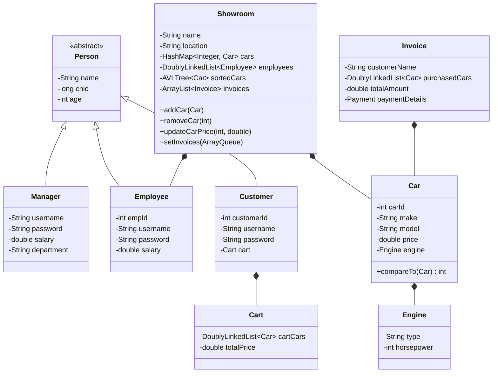
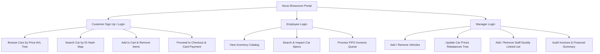
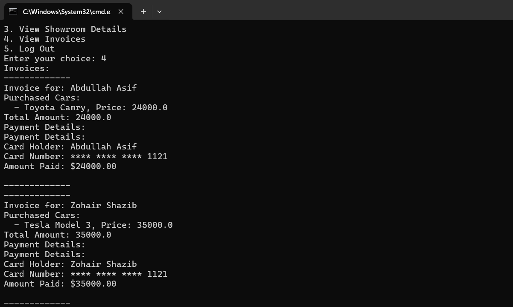

# Showroom Management System (SMS) — DSA Edition

[](https://www.oracle.com/java/)
[](./DSA/datastructures)
[](#system-architecture)
[](#license)

A high-performance **Automobile Showroom Management System** engineered in Java. This project replaces standard Java collection libraries (`java.util.*`) with **custom, ground-up implementations of fundamental data structures** (AVL Tree, Hash Map with separate chaining, Doubly Linked List, and Circular Queue). 

The system models real-world dealership operations, featuring multi-role authentication (Manager, Employee, Customer), shopping cart workflows, automated invoice queuing, and price-sorted inventory indexing.

---

## Table of Contents
1. [Key Highlights & DSA Implementations](#-key-highlights--dsa-implementations)
2. [Data Structure Complexity Analysis](#-data-structure-complexity-analysis)
3. [System Architecture](#-system-architecture)
4. [Role-Based Portals & Features](#-role-based-portals--features)
5. [Directory Layout](#-directory-layout)
6. [Compilation & Execution](#-compilation--execution)
7. [Demo Accounts & Test Credentials](#-demo-accounts--test-credentials)
8. [Screenshots](#-screenshots)

---

## Key Highlights & DSA Implementations

Rather than relying on ready-made Java collections for business operations, this project implements core computer science data structures from scratch inside the [`datastructures`](./DSA/datastructures/) package:

### 1. **AVL Tree (`AVLTree<T extends Comparable<T>>`)**
* **Application:** Maintains showroom inventory dynamically ordered by vehicle price and model.
* **Mechanism:** Self-balancing binary search tree using height balancing. Employs Left-Left (LL), Right-Right (RR), Left-Right (LR), and Right-Left (RL) rotations upon insertion and deletion to strictly maintain balance factor $\in \{-1, 0, 1\}$.
* **Benefit:** Eliminates worst-case $O(n)$ degeneration of standard BSTs, guaranteeing $O(\log n)$ price queries and in-order sorted catalog display.

### 2. **Hash Map (`HashMap<K, V>`)**
* **Application:** Car inventory lookup by unique `carId`.
* **Mechanism:** Hash table with **separate chaining** collision resolution (linked entries) and dynamic table expansion (load factor threshold = $0.75$).
* **Benefit:** Delivers amortized $O(1)$ fast retrieval, deletion, and insertion when updating car specifications or searching by ID.

### 3. **Doubly Linked List (`DoublyLinkedList<T>`)**
* **Application:** User records (`Manager`, `Employee`, `Customer`) and active shopping cart items.
* **Mechanism:** Bi-directional node linkage with `head` and `tail` pointers, custom `ListIterator`, and random-access safety checks.
* **Benefit:** Constant time $O(1)$ insertions/deletions at endpoints and flexible bidirectional sequential traversals.

### 4. **Circular Array Queue (`ArrayQueue<T>`)**
* **Application:** Billing & pending order fulfillment (`Invoice` processing pipeline).
* **Mechanism:** FIFO (First-In, First-Out) circular buffer using modular arithmetic `(rear + 1) % capacity` with automated capacity doubling upon overflow.
* **Benefit:** Fair, strict chronological order for customer checkout and transaction auditing.

### 5. **Dynamic Array List (`ArrayList<T>`)**
* **Application:** Dynamic generic list backing storage for invoices and internal hash bucket arrays.
* **Mechanism:** Contiguous memory resizing with amortized $O(1)$ appends and indexed access.

---

## Data Structure Complexity Analysis

| Data Structure | Role in System | Access / Search | Insertion | Deletion | Space Complexity |
| :--- | :--- | :---: | :---: | :---: | :---: |
| **AVL Tree** | Price-Sorted Catalog | $O(\log n)$ | $O(\log n)$ | $O(\log n)$ | $O(n)$ |
| **Hash Map** | Car ID Lookup Index | $O(1)$ avg / $O(n)$ worst | $O(1)$ avg / $O(n)$ worst | $O(1)$ avg / $O(n)$ worst | $O(n)$ |
| **Doubly Linked List** | Staff & Cart Records | $O(n)$ | $O(1)$ (head/tail) | $O(1)$ (with ref) | $O(n)$ |
| **Circular Queue** | Order & Invoice Queue | $O(1)$ (peek) | $O(1)$ (enqueue) | $O(1)$ (dequeue) | $O(n)$ |
| **Dynamic Array** | Invoices & Buckets | $O(1)$ (by index) | $O(1)$ amortized | $O(n)$ | $O(n)$ |

---

## System Architecture

### Class & Domain Model



---

## Role-Based Portals & Features



### Customer Experience
* **Registration & Secure Login:** Account creation with duplicate-username validation.
* **Interactive Shopping Cart:** Real-time total calculation, item addition, and removal.
* **Card Payment & Invoicing:** Generates timestamped order records passed directly into the fulfillment queue.

### Employee Operations
* **Inventory Inquiry:** Instant ID lookups via `HashMap`.
* **Queue Fulfillment:** Dequeues customer orders and processes pending transaction requests.

### Manager Command Center
* **Inventory Control:** Add new models, delete obsolete units, and dynamically update prices (which re-indexes and rebalances the AVL Tree).
* **HR & Staff Management:** Add and manage sales consultants within the doubly-linked employee list.
* **Full Financial Auditing:** Comprehensive invoice breakdown with total revenue calculations.

---

## Directory Layout

```
.
├── DSA/
│   ├── datastructures/           # Custom Data Structures (Zero java.util.* dependencies)
│   │   ├── AVLTree.java          # Self-balancing BST for sorted vehicle catalog
│   │   ├── HashMap.java          # Hash table with separate chaining for O(1) lookups
│   │   ├── DoublyLinkedList.java # Bi-directional list with custom iterator
│   │   ├── ArrayQueue.java       # Circular array FIFO queue for invoice processing
│   │   └── ArrayList.java        # Generic dynamic resizing array
│   ├── SS/                       # System walkthrough screenshots
│   ├── Car.java                  # Vehicle entity with Comparable implementation
│   ├── Cart.java                 # Customer cart management
│   ├── Customer.java             # Customer entity & credentials
│   ├── Employee.java             # Dealership staff entity
│   ├── Engine.java               # Engine specs (Type, Horsepower)
│   ├── Invoice.java              # Order invoice model
│   ├── Manager.java              # Administrator entity
│   ├── Payment.java              # Payment gateway & transaction model
│   ├── Person.java               # Abstract base user class
│   ├── Showroom.java             # Main controller orchestrating data structures
│   └── UsingShowroom.java        # Interactive console runner & menu system
├── DSA Project Final Submission.pdf
├── FINAL UML.psd
├── uml.png
└── README.md
```

---

## Compilation & Execution

### Prerequisites
* **Java Development Kit (JDK) 8 or higher** (JDK 17+ recommended).

### Step 1: Open Terminal & Navigate to `DSA`
```bash
cd "DSA"
```

### Step 2: Compile All Packages & Source Files
```bash
javac datastructures/*.java *.java
```

### Step 3: Launch the Showroom Application
```bash
java UsingShowroom
```

---

## Demo Accounts & Test Credentials

The system comes pre-seeded with sample data for immediate testing:

| Role | Username | Password | Notes |
| :--- | :--- | :--- | :--- |
| **Manager** | `admin` | `12P@$$w0rd` | Full administrative privileges |
| **Employee** | `ali@emp` | `12P@$$w0rd` | Sales Representative |
| **Employee** | `asad@emp` | `12P@$$w0rd` | Sales Representative |
| **Customer** | `aby` | `P@$$w0rd` | Existing customer profile |
| **Customer** | `zoi` | `12P@$$w0rd` | Existing customer profile |

*(You can also use Option `1` on the main menu to register a new Customer account at runtime).*

---

## Screenshots

| Portal | Screenshot Preview |
| :--- | :--- |
| **Manager Dashboard** |  |
| **Customer Portal** |  |
| **Employee Dashboard** |  |
| **Invoices & Billing** |  |
| **Showroom Inventory** |  |
| **Customer Registration** |  |

---

## License
This project was developed for academic and educational evaluation in **Data Structures and Algorithms (DSA Theory & Lab)**. Free to study, reference, and build upon.
